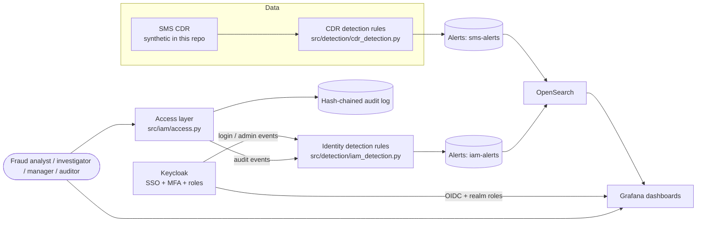

# Architecture

## Components

| Component | Responsibility | In repo |
|---|---|---|
| CDR detection | Rule-based, scored per connection per 5-min window | `src/detection/cdr_detection.py` |
| Identity detection | Rules over login/admin/audit events, mapped to MITRE ATT&CK | `src/detection/iam_detection.py` |
| Access layer | Role -> permission checks, masking, justified unmask, approval workflow | `src/iam/access.py` |
| Audit log | Tamper-evident (hash chain) record of every access decision | `src/iam/audit.py` |
| Keycloak | Authentication (SSO, MFA, brute-force lockout), realm roles | `iam/keycloak/realm-export.json` |
| OpenSearch + Grafana | Alert storage and dashboards, login via Keycloak OIDC | `docker-compose.yml`, `grafana/` |

## Key design decisions

1. **Detection is rule-based, not ML.** Rules are explainable and auditable; thresholds live in `config/rules.yaml` with a change history in git.
2. **Identity is the unit of response.** Alerts are keyed by `client_connection_name`; the recommended action is a connection-level throttle/suspend request that needs a second person to approve.
3. **Only alerts are indexed.** Raw CDR rows and full numbers never reach OpenSearch/Grafana. Unmasking happens in the access layer, with a written justification and an audit entry.
4. **Identity admin is not a data viewer.** `platform_admin` manages accounts but holds no fraud-data permission; it is deliberately unmapped in Grafana.
5. **P2P/P2A traffic is scoped out of A2P rules.** Many senders to a few application-owned numbers looks like pumping but is normal (see `tests/test_detection.py::test_p2p_would_false_positive_without_scoping`).
6. **Detection quality is measured** against injected scenarios with ground truth, including a check for unexplained alerts across several random seeds.
